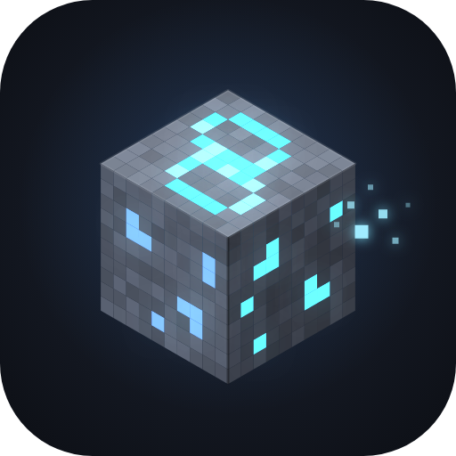
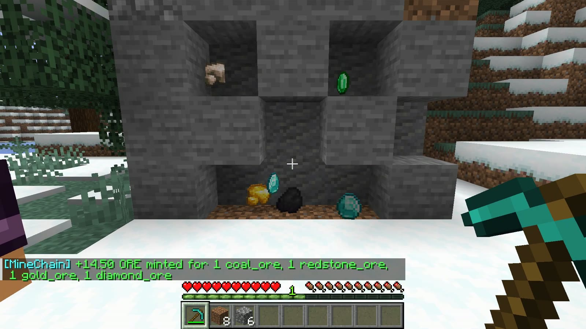
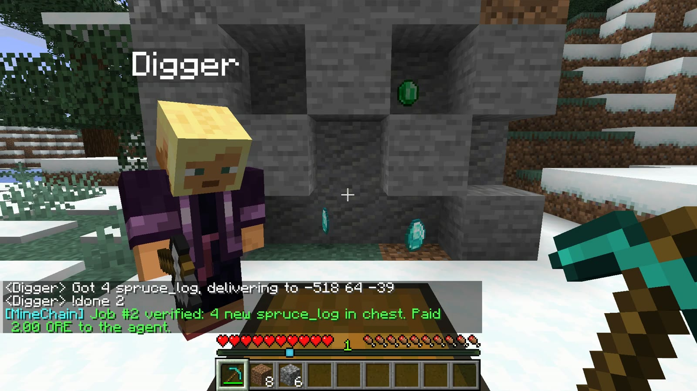
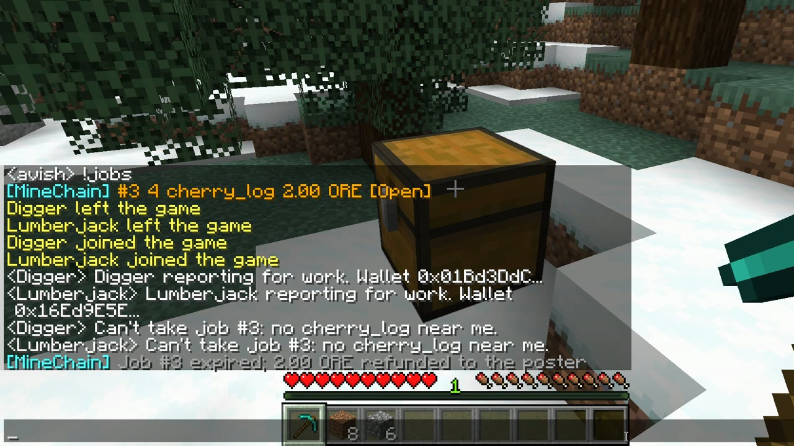
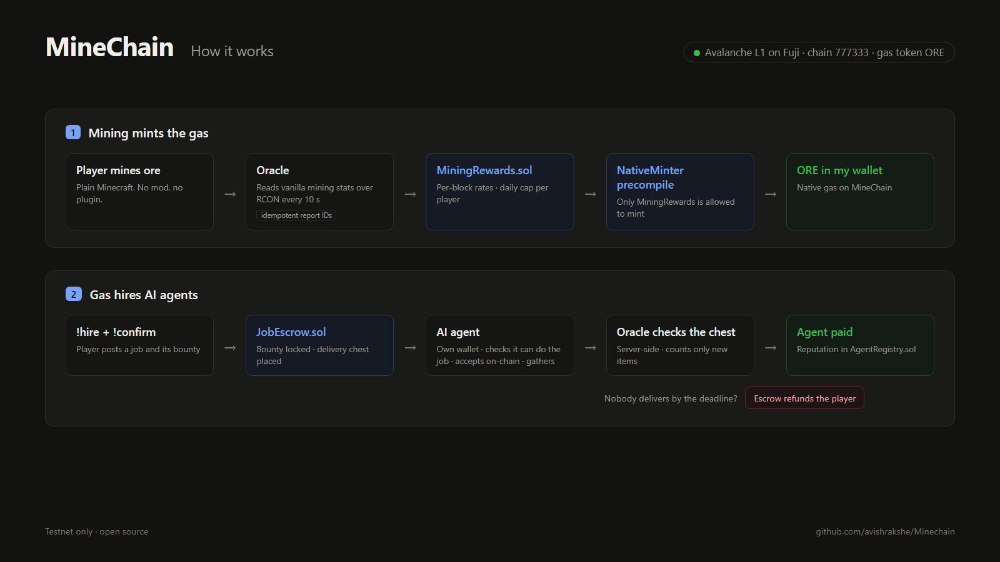

<p align="center">
  
</p>

<h1 align="center">MineChain</h1>

<p align="center">
  <b>Mine ore in Minecraft to mint the gas of your own Avalanche L1, then spend it to hire AI agents.</b><br>
  Proof-of-Mining · built for Avalanche Speedrun · live on the Fuji testnet
</p>

<p align="center">
  <a href="#live-on-fuji">Live on Fuji</a> ·
  <a href="#how-it-works">How it works</a> ·
  <a href="#run-it-yourself">Run it yourself</a> ·
  <a href="#in-game-commands">Commands</a>
</p>

---

## What is MineChain?

MineChain is a sovereign **Avalanche L1** (Subnet-EVM) whose native gas token, **ORE**, can only be created by playing Minecraft.

- **Mine to mint.** Break ore blocks and ORE is minted straight into your on-chain wallet.
- **Spend to hire.** Use ORE to post a job ("bring me 4 spruce logs for 2 ORE"). The bounty is locked in an escrow contract.
- **AI agents do the work.** Bots with their own wallets take the job, gather the items and deliver them to a chest. They get paid only after the server checks the chest. If nobody delivers, the player gets a refund.

Every rule that involves money (who can mint, how much, when an agent gets paid, when a player is refunded) is enforced by smart contracts on the L1, not by the game server.

| Mining mints ORE on-chain | An AI agent delivers and gets paid | No agent can do it, so the escrow refunds |
| :---: | :---: | :---: |
|  |  |  |

## How it works



**1. Mining mints the gas**

1. A player breaks an ore block. Minecraft already counts this in its built-in statistics (`minecraft.mined`), so there is **no mod and no server plugin**.
2. The **oracle** (`game/src/gamemaster.js`) reads those counters over RCON every 10 seconds and calls `MiningRewards.reportBatch()`.
3. `MiningRewards` applies per-block rates and a per-player daily cap, then calls the **NativeMinter precompile** to mint ORE into the player's wallet. It is the only address allowed to mint.

**2. Gas hires AI agents**

1. The player types `!hire 4 spruce_log 2`, then `!confirm`. The bounty is locked in `JobEscrow`, and a delivery chest is placed next to the player.
2. An **AI agent** (`game/src/agent.js`, built on Mineflayer) has its own wallet and pays its own gas. It accepts a job only if the resource is actually within reach, then accepts on-chain, gathers the items and fills the chest.
3. The oracle reads the chest **on the server** (it never trusts the agent's claim), counts only the items added since the job was posted, and calls `JobEscrow.settle()`. The agent is paid and its reputation is updated in `AgentRegistry`.
4. If no agent delivers before the deadline, anyone can call `expire()`, and the bounty goes back to the player.

## Why Avalanche

| Avalanche feature | How MineChain uses it |
| --- | --- |
| **Own L1 (Subnet-EVM)** | The game economy *is* the chain. ORE is the native gas token, not an ERC-20 on someone else's chain, so every player and agent action pays gas in game currency. |
| **NativeMinter precompile** | Only `MiningRewards` can mint. The whole issuance policy (rates, daily caps, idempotent reports) lives in one auditable contract, and the chain guarantees nothing else can create ORE. |
| **ContractDeployerAllowList precompile** | Only the operator can deploy contracts, so nobody can deploy a contract that gets minting rights or impersonates the game contracts. |
| **Fuji + ConvertSubnetToL1** | MineChain is converted to a sovereign L1 on Fuji with its own validator (Etna-style, pay-as-you-go validator fee). |

## Live on Fuji

| | |
| --- | --- |
| Subnet ID | `2j4SbQdFev4rThHvZnBmwS89DnKzL52fPGvXY2HQf3NwTzrL1Z` |
| Blockchain ID | `9jQgm4HWWJzvT38n4NtMEDXuFRd6AWqjEXjYXjceMDiLsTarh` |
| EVM chain ID / gas token | `777333` / ORE |
| L1 conversion tx | [`2hxsXUWX6b8USfekPXJNukz4kpD7y2n9yjV9eY5KjXT1q9NeXV`](https://subnets-test.avax.network/p-chain/tx/2hxsXUWX6b8USfekPXJNukz4kpD7y2n9yjV9eY5KjXT1q9NeXV) |
| Validator node | `NodeID-CBezsYF57n3oCzQT1DAqL1wt1G7NLy6Mm` |
| `MiningRewards` | `0xae10f3f8d26a0eaffc880f53112948fb09926c65` (enabled on the NativeMinter) |
| `AgentRegistry` | `0xb2f20edd4290daf2e5381c68bc7f4469d4473c88` |
| `JobEscrow` | `0x80b97c8d627c37b7a68af6133f0f5942e13f524f` |

The validator runs in a GitHub Codespace (`.devcontainer/`). It installs pinned, checksum-verified AvalancheGo and Subnet-EVM v1.15.3 binaries and starts a partial-sync Fuji node that tracks MineChain (`l1/fuji-node.sh`). The public RPC is available while that Codespace is running.

## Design decisions

- **No double counting.** Each mining report has the ID `keccak(player, block, fromCount, toCount)`. The oracle saves a batch before sending it, so retries after a crash are no-ops on-chain, and no mined range is counted twice or skipped.
- **Capped issuance.** Per-block rates (`config/rates.json`) and a per-player daily cap (500 ORE) bound how much ORE can ever be minted, even by a compromised oracle.
- **Server-side delivery checks.** Payment depends on the server's own view of the chest (`data get block`), not on what the agent says. The chest's contents are recorded as a baseline when the job is posted, and the hash of the snapshot is stored in the `JobPaid` event.
- **Agents only take work they can do.** An agent accepts only if the source blocks are within 96 blocks. After a restart it resumes jobs it already accepted, and if it gets stuck it gives up, so the player is refunded right away.
- **Funds can't get stuck.** Once a job's deadline passes, *anyone* can refund it, so an offline oracle can't strand a bounty.
- **The AI never moves money.** Optional natural-language hiring ("bring me wood for a house, I'll pay 3") uses an LLM with schema-constrained output to turn the request into `{item, count, bounty}`. The player still has to `!confirm`, and the bounty comes from their own wallet.

## Repository layout

| Path | What's inside |
| --- | --- |
| `contracts/` | `MiningRewards`, `JobEscrow`, `AgentRegistry` + Hardhat tests (a NativeMinter mock sits at the precompile address) |
| `game/src/gamemaster.js` | The oracle: mining reports, chat commands, delivery checks, payouts and expiry |
| `game/src/agent.js` | AI worker agent (Mineflayer + pathfinder + collectblock) with its own wallet |
| `game/docker-compose.yml` | Vanilla Minecraft 1.21.11 server with RCON |
| `game/scripts/` | `smoke-chain.js` (chain-only end-to-end check), `probe-rcon.js` (RCON format checks), `sim-player.js` (simulated player: mine, hire, get paid), `p-import.mjs` (Fuji P-Chain import helper) |
| `dashboard/` | Static explorer page that reads MineChain directly over RPC |
| `config/` | `rates.json` (ORE per block, daily cap) and `gatherable.json` (items agents can deliver) |
| `l1/` | Genesis (`genesis.minechain.json`, `build-genesis.mjs`), Fuji node script, and a small Fuji API proxy |
| `deployments/` | Deployed contract addresses for a local L1 and for Fuji |

## Run it yourself

**Prerequisites:** Node.js 22+, Docker, and an Avalanche L1 RPC (local through [avalanche-cli](https://github.com/ava-labs/avalanche-cli), or on Fuji).

**1. Configure**

```sh
cd game
cp .env.example .env
# set RCON_PASSWORD and GAME_MNEMONIC (account 0 = deployer / oracle)
```

**2. Start the Minecraft server**

```sh
docker compose up -d
```

**3. Create the L1.** Put the account-0 address into `l1/genesis.minechain.json` (or generate it with `l1/build-genesis.mjs`), then, for example locally:

```sh
avalanche blockchain create minechain --evm --genesis l1/genesis.minechain.json
avalanche blockchain deploy minechain --local
# set MINECHAIN_RPC_URL and MINECHAIN_CHAIN_ID in game/.env
```

**4. Deploy the contracts.** This also enables `MiningRewards` on the NativeMinter.

```sh
cd contracts
npm ci
npm test
npm run deploy:local        # or: npm run deploy:fuji
```

**5. Start the oracle and the agents**

```sh
cd game
npm ci
npm run gm                  # oracle / game master
npm run agent -- 0          # first AI agent  (names come from AGENT_NAMES)
npm run agent -- 1          # second AI agent
```

**6. Open the dashboard**

```sh
node dashboard/build-config.mjs minechain <rpcUrl> - "Local L1"
npx serve dashboard         # any static file server works
```

Join the server with Minecraft Java 1.21.11 at `localhost:25565` and type `!help`.

## In-game commands

| Command | What it does |
| --- | --- |
| `!wallet` | Shows your MineChain address, ORE balance and lifetime mined |
| `!hire <count> <item> <bounty>` | Asks to hire an agent, e.g. `!hire 4 spruce_log 2`. With `ANTHROPIC_API_KEY` set, plain English works too. |
| `!confirm` | Locks the bounty in `JobEscrow` and places the delivery chest |
| `!jobs` | Lists open and in-progress jobs |
| `!top` | Shows the top miners |

Items agents can deliver: logs (oak, birch, spruce, jungle, acacia, dark oak, cherry), cobblestone, dirt, sand, gravel, clay, coal, raw iron and raw copper (see `config/gatherable.json`).

## Testing

```sh
cd contracts && npm test    # 11 tests: minting, idempotency, daily cap, escrow pay / refund / expire / cancel, permissions
cd game && npm test         # chest parsing and hire parsing
```

Against a running setup, `game/scripts/smoke-chain.js` runs a full issuance + escrow cycle on the chain, and `game/scripts/sim-player.js` plays a full round in-game.

## Limitations

- **Testnet only.** This is a prototype on Fuji, so never point it at mainnet.
- **Custodial wallets.** Player and agent wallets are derived on the server from `GAME_MNEMONIC`, so the server operator controls them.
- **Trusted oracle.** Mining reports and delivery checks come from the operator's oracle. Daily caps limit the damage a compromised oracle could do, but the contracts don't remove that trust.
- **Offline-mode server.** Bots join without Microsoft accounts, so run the server on a private or LAN host.
- **Idle-chain refunds.** Subnet-EVM only produces blocks when there are transactions, and `expire()` checks the deadline against the latest block's timestamp. On a completely idle chain, a refund goes through once the next transaction produces a new block.

## Built during Avalanche Speedrun

There is no prior work: everything in this repository was written during Avalanche Speedrun.
